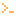

<p align="center"><a href="https://jarrow.pages.dev">Website</a> · <a href="https://jarrow.pages.dev/convert/">Convert</a> · <a href="https://jarrow.pages.dev/board/">Board</a> · <a href="https://jarrow.pages.dev/docs/">Docs</a> · <a href="https://github.com/jarrow-dev/jarrow/releases">Releases</a> · <a href="ROADMAP.md">Roadmap</a> · <a href="CONTRIBUTING.md">Contributing</a></p>

<p align="center"><a href="https://github.com/jarrow-dev/jarrow/actions/workflows/ci.yml"></a> <a href="https://github.com/jarrow-dev/jarrow/actions/workflows/nightly.yml"></a> <a href="https://jarrow.pages.dev/board/"></a> <a href="https://scorecard.dev/viewer/?uri=github.com/jarrow-dev/jarrow"></a> <a href="https://www.bestpractices.dev/projects/16297"></a> <a href="LICENSE"></a></p>

Jarrow converts a Minecraft mod JAR between Fabric, NeoForge, Forge and Quilt: 12 directions on 3 Minecraft versions, each result checked by a behaviour harness.

Status: pre-alpha, milestone M1 of M0–M6; nothing converts yet. Progress is in [LEDGER.md](LEDGER.md).

## Try it

```bash
cargo install --locked --git https://github.com/jarrow-dev/jarrow jarrow
jarrow convert my-mod.jar   # prints "Not built yet" until milestone M2
```

## How it's proven

- **Tier A:** converted in your browser by Rust compiled to WebAssembly; 0 bytes of the JAR leave your machine.
- **Tier B:** 1 short-lived GitHub Actions job decompiles, applies the rules, recompiles, runs the harness and wipes its workspace.
- **Unsupported:** the page names which of 4 blockers applies (native code, bytecode transformers, obfuscation, a licence that forbids changes) and converts nothing.

The harness starts 2 servers, the source loader with the original JAR and the target loader with the converted one, each on seed 20261103 with a 3 GB heap and a 6-minute limit. It dumps 9 categories (mods, registries, tags, recipes, loot tables, advancements, worldgen, log and probe errors) and lets worldgen counts drift by 16 blocks or 2% between runs of the same server. Each comparison lands in 1 of 5 bands: 1.0 and 0.75 are green, 0.5 is yellow, 0.25 and 0 are red.

## Who works on Jarrow

Generated nightly from the commit log.

<!-- ALL-CONTRIBUTORS-LIST:START - Do not remove or modify this section -->
<!-- prettier-ignore-start -->
<!-- markdownlint-disable -->
### People

<table>
<tr><td align="center" valign="top" width="33%"><a href="https://github.com/MosheByte"><br><b>MosheByte</b></a><br><sub>Maintainer; holds the accounts</sub><br><sub>18 commits</sub></td></tr>
</table>

###  Agents

<table>
<tr><td align="center" valign="top" width="33%"><a href="https://www.anthropic.com/claude"><b>Claude Opus 5.5</b></a><br><sub>Writes the code and docs</sub><br><sub>18 commits</sub></td></tr>
</table>

###  Bots and automation

<table>
<tr><td align="center" valign="top" width="33%"><a href="https://codeql.github.com"><b>CodeQL</b></a><br><sub>Static analysis on every PR</sub><br><sub>0 commits</sub></td><td align="center" valign="top" width="33%"><a href="https://github.com/apps/dependabot"><b>Dependabot</b></a><br><sub>Security and dependency updates</sub><br><sub>0 commits</sub></td><td align="center" valign="top" width="33%"><a href="https://github.com/apps/github-actions"><b>GitHub Actions</b></a><br><sub>Runs CI and nightly jobs</sub><br><sub>0 commits</sub></td></tr>
<tr><td align="center" valign="top" width="33%"><a href="https://github.com/jarrow-dev/jarrow/blob/main/.github/workflows/board.yml"><b>jarrow-bot (deploy key)</b></a><br><sub>Pushes to protected branches</sub><br><sub>0 commits</sub></td><td align="center" valign="top" width="33%"><a href="https://github.com/apps/renovate"><b>Renovate</b></a><br><sub>Grouped dependency update PRs</sub><br><sub>0 commits</sub></td></tr>
</table>

<!-- markdownlint-restore -->
<!-- prettier-ignore-end -->
<!-- ALL-CONTRIBUTORS-LIST:END -->

## Built by an agent

<!-- AGENT-STATS:START - generated by tools/contributors.py -->
18 of 18 commits, 11 pull requests and 518 tests written by Claude Opus 5.5, disclosed in every commit trailer.
<!-- AGENT-STATS:END -->

MIT ([LICENSE](LICENSE)); the rule tables under `rules/` are CC0-1.0, free to reuse for any loader.

<picture><source media="(prefers-color-scheme: dark)" srcset="docs/media/rust-logo-white.svg"></picture> Made in the open, in Rust. <sub>Logo © Rust Foundation, <a href="https://creativecommons.org/licenses/by/4.0/">CC BY 4.0</a>, filled white in dark mode.</sub>

Not an official Minecraft product. Not approved by or associated with Mojang or Microsoft. Not affiliated with the Fabric, NeoForge, Forge or Quilt projects.
